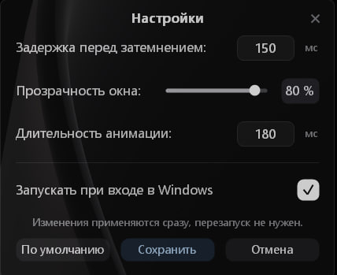
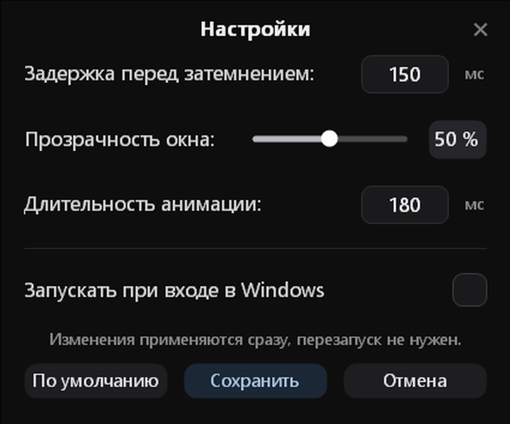
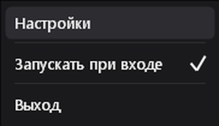

# SimpleTransparentWindow

<p align="center">
  
</p>

<p align="center">
  <b>Окно становится полупрозрачным, пока вы его перетаскиваете.</b><br>
  Лёгкая утилита для Windows 11/10: один файл, без установки, без .NET.
</p>

<p align="center">
  
  
  
  
</p>

<p align="center">
  
</p>

---

## Зачем

Вы тащите окно через весь экран, чтобы положить его рядом с другим — и оно закрывает ровно то,
что вам нужно увидеть. SimpleTransparentWindow делает перетаскиваемое окно прозрачным ровно настолько,
чтобы видеть содержимое под ним, и возвращает всё обратно, как только вы отпустили кнопку.

## Возможности

| | |
|---|---|
| 🪟 **Прозрачность при перетаскивании** | Окно плавно гаснет через заданную задержку и восстанавливается после отпускания |
| ⚙️ **Три настройки** | Задержка (0–5000 мс), прозрачность (10–90 %), длительность анимации (0–2000 мс) |
| 🔄 **Без перезапуска** | Изменения действуют сразу — на следующем перетаскивании |
| 🚀 **Автозапуск** | `HKCU\...\Run`, без прав администратора и без планировщика задач |
| 📌 **Живёт в трее** | Двойной щелчок — настройки, правый клик — меню |
| 🎭 **Два режима запуска** | Вручную — сразу настройки; при входе в Windows — молча, без окон |
| 🌙 **Тёмный интерфейс** | Собственная отрисовка в стиле Windows 11, скругления, анимации |

## Скриншоты

<table>
  <tr>
    <td align="center"><br><sub>Настройки</sub></td>
    <td align="center"><br><sub>Меню в трее</sub></td>
  </tr>
</table>

## Установка

1. Скачайте `SimpleTransparentWindow.exe` со страницы [Releases](../../releases).
2. Запустите — откроется окно настроек, иконка появится в трее.
3. Автозапуск включён по умолчанию, отключается в настройках или в меню трея.

Один файл **9.9 МБ**, .NET устанавливать не нужно — сборка self-contained и single-file.

## Как это работает

Приложение не использует стандартные контролы Windows: они не поддаются нормальной тёмной теме,
поэтому окно настроек и меню трея рисуются вручную через GDI и GDI+.

- **Перетаскивание** ловится `SetWinEventHook` (`EVENT_SYSTEM_MOVESIZESTART/END`).
  Низкоуровневый хук `WH_MOUSE_LL` здесь бесполезен — он не получает `WM_NCLBUTTONDOWN`.
- **Прозрачность** — `WS_EX_LAYERED` + `SetLayeredWindowAttributes` с плавной интерполяцией альфы
  по таймеру на 16 мс.
- **Восстановление** — в конце жеста исходный стиль `WS_EX_LAYERED` возвращается, так что чужие окна
  не остаются «слоёными» после закрытия утилиты.

## Настройки и логи

- Настройки: `%APPDATA%\SimpleTransparentWindow\config.ini`
- Логи: `%APPDATA%\SimpleTransparentWindow\logs\`

Конфиг — обычный текст, можно править руками:

```ini
delayMs=150
opacity=80
transitionMs=180
autostart=1
```

| Ключ | Значение |
|---|---|
| `delayMs` | Задержка перед началом затемнения, 0–5000 мс |
| `opacity` | Целевая прозрачность, 10–90 % |
| `transitionMs` | Длительность анимации, 0–2000 мс |
| `autostart` | `1` — запускать при входе в Windows |

## Структура

```
src/
  App.cs                 точка входа, цикл сообщений, координация модулей
  Config.cs              настройки в формате key=value
  FadeEngine.cs          анимация альфа-канала
  MoveWatcher.cs         хук начала и конца перетаскивания
  Tray.cs                иконка в трее
  PopupMenu.cs           собственное меню в стиле Windows 11
  SettingsWindow.cs      окно настроек с ручной отрисовкой
  Autostart.cs           автозапуск через реестр
  Logger.cs              файловые логи
  Native/                P/Invoke и константы Win32
  Ui/                    палитра, шрифты, обёртка GDI+
docs/                    скриншоты и промпт для разработки
build.ps1                сборка одного exe
```

## Ограничения

- Windows 10/11, x64.
- Не работает для окон, запущенных с более высокими правами: UIPI запрещает одному процессу
  менять чужие окна более высокого уровня целостности.
- Окна с собственной обработкой `WM_NCHITTEST` (часть игр, некоторые лаунчеры) могут не реагировать.
- Прозрачность гасит окно целиком, включая текст: сделать прозрачным только фон у произвольного
  чужого окна средствами Win32 нельзя.

## Лицензия

[MIT](LICENSE)
